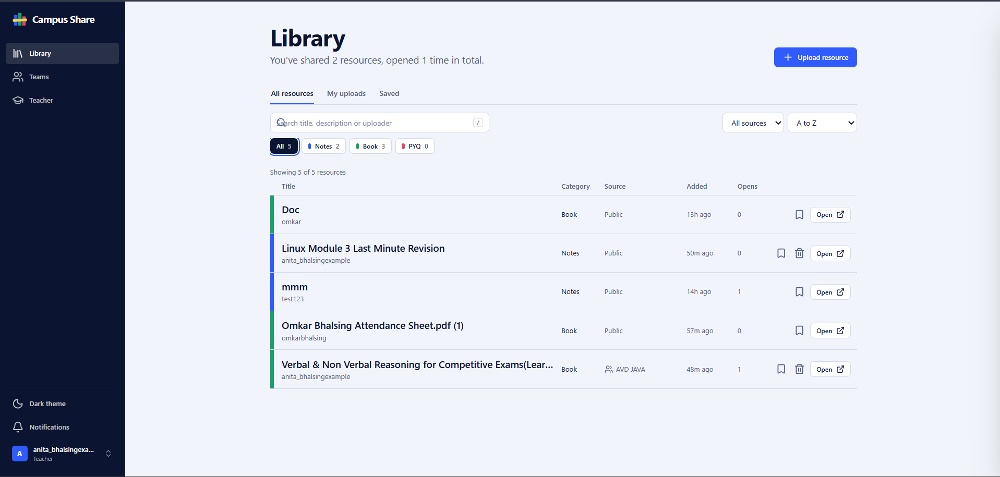
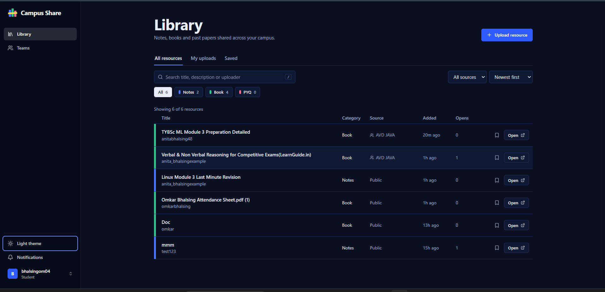
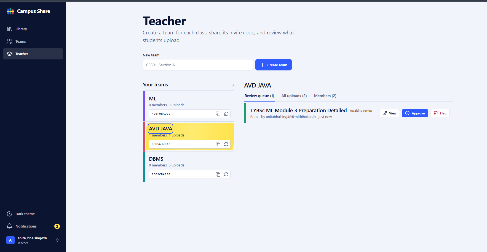
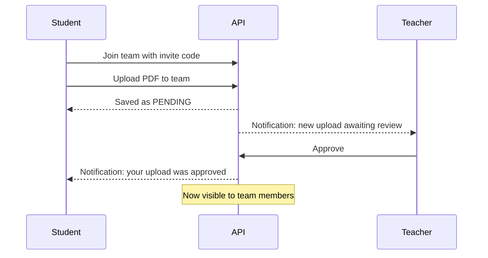

<div align="center">

# Campus Share

**A secure academic resource hub where students and teachers share notes, books and past papers, publicly or privately inside a class.**


[Features](#features) · [Screenshots](#screenshots) · [Roles](#roles-and-permissions) · [Getting started](#getting-started) · [API](#api-reference) · [Security](#security) · [Deployment](#deployment)

</div>

---

## Overview

Campus Share gives a college one place to find and share study material. Anyone can browse public notes, books and previous-year question papers (PYQs). Teachers can also create a private **team** for each class: students join with an invite code, upload into the team, and the teacher approves what goes live.

The interface is designed like a **library catalogue**: resources are rows on a shelf, each with a coloured spine for its category, and whatever you select is marked with a highlighter swipe.

## Screenshots

<!--
  Add your three screenshots to docs/screenshots/ using these exact file names.
  See the capture guide in the project notes. Delete this comment when done.
-->

<table>
  <tr>
    <td width="50%"></td>
    <td width="50%"></td>
  </tr>
  <tr>
    <td align="center"><sub><b>Teams on the left; the selected team's review queue, uploads and members on the right.</sub></td>
    <td align="center"><sub><b>Library, dark theme.</b> Follows your system on first visit and remembers your choice.</sub></td>
  </tr>
</table>

<p align="center">
  
  <br />
  <td align="center"><sub><b>Library, light theme.</b> Coloured spines per category, and the selected row marked in yellow.</sub></td>
</p>

---

## Features

### For everyone

| Feature                   | What it does                                                                                                                                                                                    |
| ------------------------- | ----------------------------------------------------------------------------------------------------------------------------------------------------------------------------------------------- |
| **Resource library**      | Upload and browse **Notes**, **Books** and **PYQs** as PDFs in a table-style catalogue.                                                                                                         |
| **Search, filter, sort**  | Instant search across title, description and uploader. Filter by category, by source (public or a specific team), and by view (All, My uploads, Saved). Sort by newest, most opened, or A to Z. |
| **Save for later**        | Bookmark any resource and find it again under the **Saved** tab.                                                                                                                                |
| **Select to read more**   | Click a row to mark it with the highlighter and reveal its full description. Press `Esc` to clear.                                                                                              |
| **Notifications**         | A live bell for approvals, flags, uploads awaiting review and new team members. Polls every minute and refreshes when you return to the tab.                                                    |
| **Profile and settings**  | A profile panel listing your uploads (with delete), and a settings dialog to change your password with a strength meter.                                                                        |
| **Light and dark themes** | A toggle in the sidebar. The first visit follows your system setting; after that, your choice is remembered.                                                                                    |
| **Responsive layout**     | A sidebar on desktop, and a top bar with a bottom tab bar on phones. Dialogs become bottom sheets on small screens.                                                                             |
| **Keyboard friendly**     | `/` focuses search, `Esc` clears the selection or closes dialogs, visible focus states throughout. Reduced-motion preferences are respected.                                                    |

### For teachers

| Feature               | What it does                                                                                                 |
| --------------------- | ------------------------------------------------------------------------------------------------------------ |
| **Class teams**       | Create a team per class (for example "CS301, Section A") and get an invite code.                             |
| **Invite codes**      | Copy a team's code in one click, or regenerate it. The old code stops working immediately.                   |
| **Review queue**      | Student uploads to a team arrive as _Awaiting approval_. Approve or flag each one; the uploader is notified. |
| **Member management** | See who has joined a team and remove members.                                                                |
| **Team-wide delete**  | Remove any resource uploaded to a team you teach.                                                            |

### For admins

Admins can moderate and delete any resource and change user roles.

<details>
<summary><b>What each role sees in the navigation</b></summary>

- **Student:** Library, Teams.
- **Teacher:** Library, Teams, Teacher. The Library also shows a banner when uploads are waiting for review.
- **Admin:** same as Teacher, with extra moderation rights on the API.

</details>

---

## How it works

**Opening a file.** The browser asks `GET /api/resources/:id/access`. The API verifies the token, loads the user's current role, checks team membership and approval status, then returns a signed S3 link that expires in 5 minutes. Raw file URLs are never sent to the client.

**Team upload flow.**



Uploads from a teacher, and public uploads, go live immediately. Uploads from students into a team wait for approval.

---

## Tech stack

| Layer        | Technology                                                                             |
| ------------ | -------------------------------------------------------------------------------------- |
| Frontend     | React 19, Vite 7, React Router 7, Tailwind CSS 4, Axios, Sonner (toasts), Lucide icons |
| Backend      | Node.js 18+, Express 5, Prisma ORM                                                     |
| Database     | PostgreSQL                                                                             |
| File storage | AWS S3 with signed URLs                                                                |
| Auth         | JWT, bcrypt (cost 12)                                                                  |
| Type         | Bricolage Grotesque (headings), Instrument Sans (body)                                 |

---

## Design system

The UI is built from a small set of tokens defined once in `client/src/index.css` and switched by a `data-theme` attribute on `<html>`.

- **Palette:** deep ink navy and cool paper white, with cobalt buttons in both themes.
- **Category spines:** Notes (cobalt), Book (green), PYQ (rose). Teams get a stable spine colour derived from their name.
- **The highlighter:** yellow is reserved for one purpose, the mark that swipes across a selected row. Colours inside the mark are re-pinned so text stays readable in both themes.
- **Theme logic:** `client/src/utils/theme.js` is a small store that follows the system until the user toggles, then persists the choice. An inline script in `index.html` applies it before first paint to avoid a flash.
- **Layout:** `AppShell` provides the desktop sidebar and phone tab bar; `AuthLayout` provides the split-screen sign-in and sign-up.

---

## Project structure

```
campus-share/
├── client/                      # React frontend
│   ├── public/favicon.svg
│   └── src/
│       ├── components/          # AppShell, AuthLayout, Modal, UploadModal, SettingsModal,
│       │                        # ProfileSidebar, AccountMenu, NotificationBell, ThemeToggle ...
│       ├── pages/               # Dashboard (Library), Teams, TeacherDashboard, Login, Register
│       ├── utils/               # theme store, spine colours, auth helpers, formatters
│       ├── api.js               # axios instance + session handling
│       └── index.css            # design tokens and component styles
└── server/                      # Express backend
    ├── prisma/schema.prisma     # User, Team, TeamMember, Resource, Bookmark, Notification
    ├── scripts/setRole.js       # promote users to TEACHER / ADMIN
    └── src/
        ├── controllers/         # auth, resource, team, user, notification
        ├── middleware/          # auth, requireRole, requireTeamOwnership, rate limiters, multer
        ├── routes/
        └── utils/               # notify, s3, token, access
```

---

## Getting started

**Prerequisites:** Node.js 18+, a PostgreSQL database, and an AWS S3 bucket with an IAM user that can read, write and delete objects in it.

### 1. Clone

```bash
git clone https://github.com/omkargitcs/campus-share.git
cd campus-share
```

### 2. Backend

```bash
cd server
npm install
cp .env.example .env          # fill in the values below
npx prisma db push            # creates or updates the tables
npm run dev                   # http://localhost:5000
```

<details>
<summary><b>Backend environment variables</b></summary>

| Variable                | Required          | Description                                                                                                                                        |
| ----------------------- | ----------------- | -------------------------------------------------------------------------------------------------------------------------------------------------- |
| `DATABASE_URL`          | Yes               | PostgreSQL connection string                                                                                                                       |
| `JWT_SECRET`            | Yes               | Long random string (32+ characters). The server refuses to start without it.                                                                       |
| `CLIENT_ORIGIN`         | Yes in production | Frontend URL(s), comma-separated, no trailing slash. Other origins are blocked by CORS. If unset, the server logs a warning and allows any origin. |
| `AWS_ACCESS_KEY_ID`     | Yes               | IAM access key                                                                                                                                     |
| `AWS_SECRET_ACCESS_KEY` | Yes               | IAM secret                                                                                                                                         |
| `AWS_REGION`            | Yes               | For example `ap-south-1`                                                                                                                           |
| `AWS_BUCKET_NAME`       | Yes               | Bucket that stores the PDFs                                                                                                                        |
| `ALLOWED_EMAIL_DOMAINS` | Optional          | For example `mithibai.ac.in` to restrict sign-up to your college                                                                                   |
| `TEACHER_INVITE_CODE`   | Optional          | Secret code a teacher enters on the sign-up page to get a Teacher account. Leave empty to disable (then use `npm run set-role`).                   |
| `PORT`                  | Optional          | Defaults to `5000`                                                                                                                                 |

Generate a secret:

```bash
node -e "console.log(require('crypto').randomBytes(48).toString('hex'))"
```

</details>

### 3. Frontend

```bash
cd client
npm install
echo "VITE_API_URL=http://localhost:5000" > .env
npm run dev                   # http://localhost:5173
```

### 4. Create your first teacher and admin

Everyone registers as a **Student** unless they enter the optional `TEACHER_INVITE_CODE`. Promote accounts from the `server` folder (set `DATABASE_URL` first; for a hosted database use its external URL):

```bash
npm run set-role -- teacher@college.edu TEACHER
npm run set-role -- you@college.edu ADMIN
```

Admins can also change roles through the API (`PATCH /api/users/:id/role`).

### Scripts

| Where    | Command                              | Purpose                          |
| -------- | ------------------------------------ | -------------------------------- |
| `server` | `npm run dev`                        | Start the API with file watching |
| `server` | `npm start`                          | Start the API                    |
| `server` | `npm run set-role -- <email> <ROLE>` | Promote a user                   |
| `client` | `npm run dev`                        | Start the Vite dev server        |
| `client` | `npm run build`                      | Production build                 |
| `client` | `npm run lint`                       | Run ESLint                       |

---

## Roles and permissions

| Action                                 |       Student        |          Teacher           | Admin |
| -------------------------------------- | :------------------: | :------------------------: | :---: |
| Browse public resources                |         Yes          |            Yes             |  Yes  |
| Upload publicly                        |         Yes          |            Yes             |  Yes  |
| Join a team with an invite code        |         Yes          |            Yes             |  Yes  |
| Upload to a team they belong to        | Yes (needs approval) |    Yes (auto-approved)     |  Yes  |
| View team resources                    |     Members only     |         Own teams          |  All  |
| Create a team                          |          No          |            Yes             |  Yes  |
| Approve or flag team uploads           |          No          |         Own teams          |  All  |
| Remove members, regenerate invite code |          No          |         Own teams          |  No   |
| Delete a resource                      |     Own uploads      | Own uploads and own team's |  All  |
| Change user roles                      |          No          |             No             |  Yes  |

> Permissions are enforced **on the server**. The interface only hides buttons for convenience.

---

## API reference

All routes are under `/api` and require `Authorization: Bearer <token>`, except register, login and health.

<details>
<summary><b>Auth and users</b></summary>

| Method | Endpoint          | Access | Purpose                                                       |
| ------ | ----------------- | ------ | ------------------------------------------------------------- |
| POST   | `/auth/register`  | Public | Create an account (Student, or Teacher with the teacher code) |
| POST   | `/auth/login`     | Public | Returns a JWT and the user                                    |
| GET    | `/users/profile`  | User   | Own profile and uploads                                       |
| PATCH  | `/users/password` | User   | Change password (signs out all other sessions)                |
| GET    | `/users?q=`       | Admin  | Search users                                                  |
| PATCH  | `/users/:id/role` | Admin  | Set a user's role                                             |

</details>

<details>
<summary><b>Resources</b></summary>

| Method       | Endpoint                  | Access                     | Purpose                                                 |
| ------------ | ------------------------- | -------------------------- | ------------------------------------------------------- |
| GET          | `/resources`              | User                       | Resources the caller is allowed to see                  |
| POST         | `/resources/upload`       | User                       | Upload a PDF (`multipart/form-data`, optional `teamId`) |
| GET          | `/resources/:id/access`   | User                       | Permission-checked signed link to the PDF               |
| PUT / DELETE | `/resources/:id/bookmark` | User                       | Save or unsave                                          |
| PATCH        | `/resources/:id/status`   | Team teacher, admin        | `APPROVED` or `FLAGGED`                                 |
| DELETE       | `/resources/:id`          | Owner, team teacher, admin | Delete                                                  |

</details>

<details>
<summary><b>Teams and notifications</b></summary>

| Method | Endpoint                         | Access         | Purpose                               |
| ------ | -------------------------------- | -------------- | ------------------------------------- |
| POST   | `/teams`                         | Teacher, admin | Create a team                         |
| POST   | `/teams/join`                    | User           | Join with an invite code              |
| GET    | `/teams/mine`                    | User           | Teams you teach and teams you joined  |
| DELETE | `/teams/:teamId/leave`           | Member         | Leave a team                          |
| GET    | `/teams/:teamId/resources`       | Team teacher   | All uploads in the team               |
| GET    | `/teams/:teamId/members`         | Team teacher   | Member list                           |
| DELETE | `/teams/:teamId/members/:userId` | Team teacher   | Remove a member                       |
| POST   | `/teams/:teamId/invite`          | Team teacher   | Generate a new invite code            |
| GET    | `/notifications`                 | User           | Latest notifications and unread count |
| PATCH  | `/notifications/:id/read`        | User           | Mark one as read                      |
| PATCH  | `/notifications/read-all`        | User           | Mark all as read                      |
| GET    | `/health`                        | Public         | Health check                          |

</details>

---

## Security

- **Server-side authorization:** the user's role is re-read from the database on every request, so demotions and deletions take effect immediately.
- **Private files:** PDFs are served by 5-minute signed S3 links, and the list endpoint never exposes raw file URLs.
- **Upload validation:** PDF only, 10 MB limit, real file-signature check, randomised storage names, category whitelist and length limits.
- **Brute-force protection:** rate limits on login, registration, uploads, team joins and password changes.
- **Credentials:** bcrypt (cost 12), constant-time login responses for unknown emails, and a mandatory `JWT_SECRET`.
- **Hardening:** Helmet headers, a CORS allowlist, a 100 kb JSON body limit, and no internal error details in responses.
- **No privilege escalation:** the role is never accepted from client input. Promotion happens only through the admin script or admin API.

<details>
<summary><b>Known limitations</b></summary>

- The JWT is kept in `localStorage`, which is common for single-page apps but exposed if the site ever has an XSS bug.
- Tokens expire after 24 hours; changing your password signs out every other session immediately.
- There is no password-reset email flow yet.

</details>

---

## Deployment

| Part     | Suggested host           | Notes                                                                                                                           |
| -------- | ------------------------ | ------------------------------------------------------------------------------------------------------------------------------- |
| Frontend | Vercel                   | Set `VITE_API_URL` to your API URL (no trailing `/api`). `vercel.json` already handles SPA routing.                             |
| Backend  | Render                   | Set all backend env vars. `CLIENT_ORIGIN` must be your Vercel URL.                                                              |
| Database | Render, Neon or Supabase | Start command: `npx prisma db push && node src/index.js`. Free Render databases expire after 30 days; Neon and Supabase do not. |
| Storage  | AWS S3                   | Turn on **Block all public access**. The app reads files through signed URLs.                                                   |

---

## Manual test checklist

Run through these in **both themes**, and once on a phone-width window.

- [ ] Register, log in, and confirm the new `role` appears in the token
- [ ] The theme follows your system on first load, and your toggle choice survives a reload and a logout
- [ ] As a student, `POST /api/teams` returns `403`
- [ ] Promote a user to teacher, create a team, and copy its invite code
- [ ] Join the team with a different student account
- [ ] Upload to the team: it shows _Awaiting approval_, and the teacher's notifications show a new item
- [ ] A student outside the team cannot see or open that upload
- [ ] A different teacher cannot open `/api/teams/:teamId/resources` for that team
- [ ] Deleting another user's resource returns `403`
- [ ] A non-PDF renamed to `.pdf` is rejected
- [ ] Selecting a row marks it, and its text stays readable in light and dark
- [ ] Bottom tab bar, notifications panel and account menu work on a phone-width window

---

## Roadmap

- [ ] Password reset by email
- [ ] Per-resource comments and ratings
- [ ] Admin dashboard for role management
- [ ] Automated tests (API and UI)

---

## Contributing

1. Fork the repo and create a branch: `git checkout -b feature/your-feature`
2. Commit your changes with a clear message
3. Push and open a pull request describing what changed and why

---

<div align="center">

Built for campus communities.

</div>
