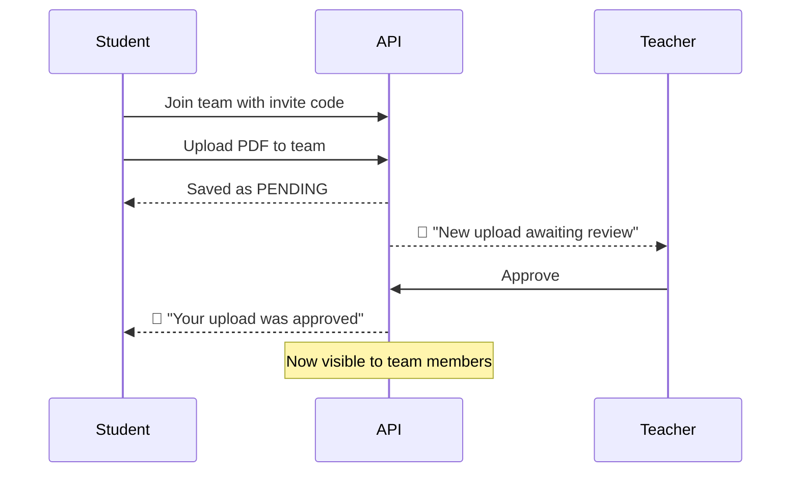

<div align="center">

# 🎓 Campus Share

**A secure academic resource hub where students and teachers share notes, books and PYQs, publicly or privately inside a class.**


[Features](#-features) · [Architecture](#-architecture) · [Quick Start](#-quick-start) · [Roles](#-roles--permissions) · [API](#-api-reference) · [Security](#-security) · [Deploy](#-deployment)

</div>

---

## ✨ Features

| | |
|---|---|
| 📚 **Resource library** | Upload and browse **Notes**, **Books** and **PYQs** as PDFs, with instant search, category filters and sorting (newest, most opened, A to Z). |
| 👥 **Class teams** | Teachers create a team per class and share an invite code. Students join with it and share notes privately with that class. |
| ✅ **Teacher moderation** | Team uploads wait in a review queue. Teachers approve, flag or remove them, and uploaders get notified. |
| 🔔 **Notifications** | A live bell for approvals, flags, new uploads awaiting review and new team members. |
| 🔖 **Save for later** | Bookmark any resource and revisit it from the **Saved** tab. |
| 🔐 **Private by default** | Files are opened through short-lived signed links after a permission check, so nobody can reach a team's PDFs by guessing a URL. |
| ⚡ **Polished UX** | Dark glassmorphism UI, upload progress bar, drag and drop, `/` to focus search, password-strength meter, skeleton loaders and toasts. |
| 📱 **Responsive** | Designed for phones, tablets and desktops. |

<details>
<summary><b>🧭 What each role sees</b></summary>

- **Student:** browses public resources, joins teams, uploads publicly or to a team, saves resources, manages their own uploads.
- **Teacher:** everything a student can do, plus creates teams, reviews uploads, manages members and invite codes.
- **Admin:** can moderate and delete any resource and change user roles.

</details>

---

## 🏗 Architecture

**How a file is opened:** the browser asks `GET /api/resources/:id/access`. The API verifies the token, loads the user's current role, checks team membership and approval status, then returns a signed S3 link that expires in 5 minutes.



<details>
<summary><b>📁 Project structure</b></summary>

```
campus-share/
├── client/                     # React frontend
│   └── src/
│       ├── components/         # Navbar, NotificationBell, UploadModal, SettingsModal, ProtectedRoute ...
│       ├── pages/              # Dashboard, Teams, TeacherDashboard, Login, Register
│       ├── utils/              # auth helpers, user context, formatters, openResource
│       └── api.js              # axios instance + session handling
└── server/                     # Express backend
    ├── prisma/schema.prisma    # User, Team, TeamMember, Resource, Bookmark, Notification
    ├── scripts/setRole.js      # promote users to TEACHER / ADMIN
    └── src/
        ├── controllers/        # auth, resource, team, user, notification
        ├── middleware/         # auth, requireRole, requireTeamOwnership, limiters, multer
        ├── routes/
        └── utils/notify.js
```

</details>

---

## 🚀 Quick Start

**Prerequisites:** Node.js 18+, a PostgreSQL database, and an AWS S3 bucket with an IAM user that can read, write and delete objects in it.

### 1. Clone

```bash
git clone https://github.com/omkargitcs/campus-share.git
cd campus-share
```

### 2. Backend

```bash
cd server
npm install
cp .env.example .env          # fill in the values below
npx prisma migrate dev        # creates the tables
npm run dev                   # http://localhost:5000
```

<details>
<summary><b>🔧 Backend environment variables</b></summary>

| Variable | Required | Description |
|---|---|---|
| `DATABASE_URL` | ✅ | PostgreSQL connection string |
| `JWT_SECRET` | ✅ | Long random string (32+ chars). The server refuses to start without it. |
| `CLIENT_ORIGIN` | ✅ in prod | Frontend URL(s), comma-separated. Anything else is blocked by CORS. |
| `AWS_ACCESS_KEY_ID` | ✅ | IAM access key |
| `AWS_SECRET_ACCESS_KEY` | ✅ | IAM secret |
| `AWS_REGION` | ✅ | e.g. `ap-south-1` |
| `AWS_BUCKET_NAME` | ✅ | Bucket that stores the PDFs |
| `ALLOWED_EMAIL_DOMAINS` | optional | e.g. `mithibai.ac.in` to restrict sign-up to your college |
| `PORT` | optional | Defaults to `5000` |

Generate a secret:

```bash
node -e "console.log(require('crypto').randomBytes(48).toString('hex'))"
```

</details>

### 3. Frontend

```bash
cd client
npm install
echo "VITE_API_URL=http://localhost:5000" > .env
npm run dev                   # http://localhost:5173
```

### 4. Create your first teacher and admin

Everyone registers as a **Student**. Promote accounts from the `server` folder:

```bash
npm run set-role -- teacher@college.edu TEACHER
npm run set-role -- you@college.edu ADMIN
```

After that, admins can also change roles through the API (`PATCH /api/users/:id/role`).

---

## 🔑 Roles & Permissions

| Action | Student | Teacher | Admin |
|---|:---:|:---:|:---:|
| Browse public resources | ✅ | ✅ | ✅ |
| Upload publicly | ✅ | ✅ | ✅ |
| Join a team with invite code | ✅ | ✅ | ✅ |
| Upload to a team they belong to | ✅ (needs approval) | ✅ (auto-approved) | ✅ |
| View team resources | members only | own teams | all |
| Create a team | ❌ | ✅ | ✅ |
| Approve / flag team uploads | ❌ | own teams | all |
| Remove members, regenerate invite code | ❌ | own teams | ❌ |
| Delete a resource | own uploads | own uploads + own team's | all |
| Change user roles | ❌ | ❌ | ✅ |

> Permissions are enforced **on the server**. The UI only hides buttons for convenience.

---

## 📡 API Reference

All routes are under `/api` and require `Authorization: Bearer <token>` except register, login and health.

<details>
<summary><b>Auth and users</b></summary>

| Method | Endpoint | Access | Purpose |
|---|---|---|---|
| POST | `/auth/register` | public | Create an account (always a Student) |
| POST | `/auth/login` | public | Returns a JWT and the user |
| GET | `/users/profile` | user | Own profile and uploads |
| PATCH | `/users/password` | user | Change password |
| GET | `/users?q=` | admin | Search users |
| PATCH | `/users/:id/role` | admin | Set a user's role |

</details>

<details>
<summary><b>Resources</b></summary>

| Method | Endpoint | Access | Purpose |
|---|---|---|---|
| GET | `/resources` | user | Resources the caller is allowed to see |
| POST | `/resources/upload` | user | Upload a PDF (`multipart/form-data`, optional `teamId`) |
| GET | `/resources/:id/access` | user | Permission-checked signed link to the PDF |
| PUT / DELETE | `/resources/:id/bookmark` | user | Save or unsave |
| PATCH | `/resources/:id/status` | team teacher, admin | `APPROVED` or `FLAGGED` |
| DELETE | `/resources/:id` | owner, team teacher, admin | Delete |

</details>

<details>
<summary><b>Teams and notifications</b></summary>

| Method | Endpoint | Access | Purpose |
|---|---|---|---|
| POST | `/teams` | teacher, admin | Create a team |
| POST | `/teams/join` | user | Join with an invite code |
| GET | `/teams/mine` | user | Teams you teach and teams you joined |
| DELETE | `/teams/:teamId/leave` | member | Leave a team |
| GET | `/teams/:teamId/resources` | team teacher | All uploads in the team |
| GET | `/teams/:teamId/members` | team teacher | Member list |
| DELETE | `/teams/:teamId/members/:userId` | team teacher | Remove a member |
| POST | `/teams/:teamId/invite` | team teacher | Generate a new invite code |
| GET | `/notifications` | user | Latest notifications and unread count |
| PATCH | `/notifications/:id/read` | user | Mark one as read |
| PATCH | `/notifications/read-all` | user | Mark all as read |
| GET | `/health` | public | Health check |

</details>

---

## 🛡 Security

- **Server-side authorization:** the user's role is re-read from the database on every request, so demotions and deletions take effect immediately.
- **Private files:** PDFs are served by 5-minute signed S3 links, and the list endpoint never exposes raw file URLs.
- **Upload validation:** PDF only, 10 MB limit, real file-signature check, randomised storage names, category whitelist and length limits.
- **Brute-force protection:** rate limits on login, registration, uploads, team joins and password changes.
- **Credentials:** bcrypt (cost 12), constant-time login responses for unknown emails, and a mandatory `JWT_SECRET`.
- **Hardening:** Helmet headers, a CORS allowlist, a 100 kb JSON body limit and no internal error details in responses.
- **No privilege escalation:** the role is never accepted from client input. Promotion happens only through the admin script or admin API.

<details>
<summary><b>Known limitations</b></summary>

- The JWT is kept in `localStorage`, which is standard for SPAs but exposed if the site ever has an XSS bug.
- Tokens stay valid for up to 24 hours after a password change.
- There is no password-reset email flow yet.

</details>

---

## ☁️ Deployment

| Part | Suggested host | Notes |
|---|---|---|
| Frontend | Vercel | Set `VITE_API_URL` to your API URL (no trailing `/api`). `vercel.json` already handles SPA routing. |
| Backend | Render | Set all backend env vars. `CLIENT_ORIGIN` must be your Vercel URL. |
| Database | Render / Neon / Supabase | Run `npx prisma migrate deploy` on release. |
| Storage | AWS S3 | Turn on **Block all public access**. The app reads files via signed URLs. |

---

## 🧪 Manual Test Checklist

- [ ] Register, log in, and confirm the new `role` appears in the token
- [ ] As a student, `POST /api/teams` returns `403`
- [ ] Promote a user to teacher, create a team, and get an invite code
- [ ] Join the team with a different student account
- [ ] Upload to the team: it shows **Awaiting approval**, and the teacher's bell lights up
- [ ] A student outside the team cannot see or open that upload
- [ ] A different teacher cannot open `/api/teams/:teamId/resources` for that team
- [ ] Deleting another user's resource returns `403`
- [ ] A non-PDF renamed to `.pdf` is rejected

---

## 🗺 Roadmap

- [ ] Password reset by email
- [ ] Per-resource comments and ratings
- [ ] Admin dashboard UI for role management
- [ ] Automated tests (API and UI)

---

## 🤝 Contributing

1. Fork the repo and create a branch: `git checkout -b feature/your-feature`
2. Commit your changes with a clear message
3. Push and open a pull request describing what changed and why

---

<div align="center">

Built with ❤️ for campus communities.

</div>
